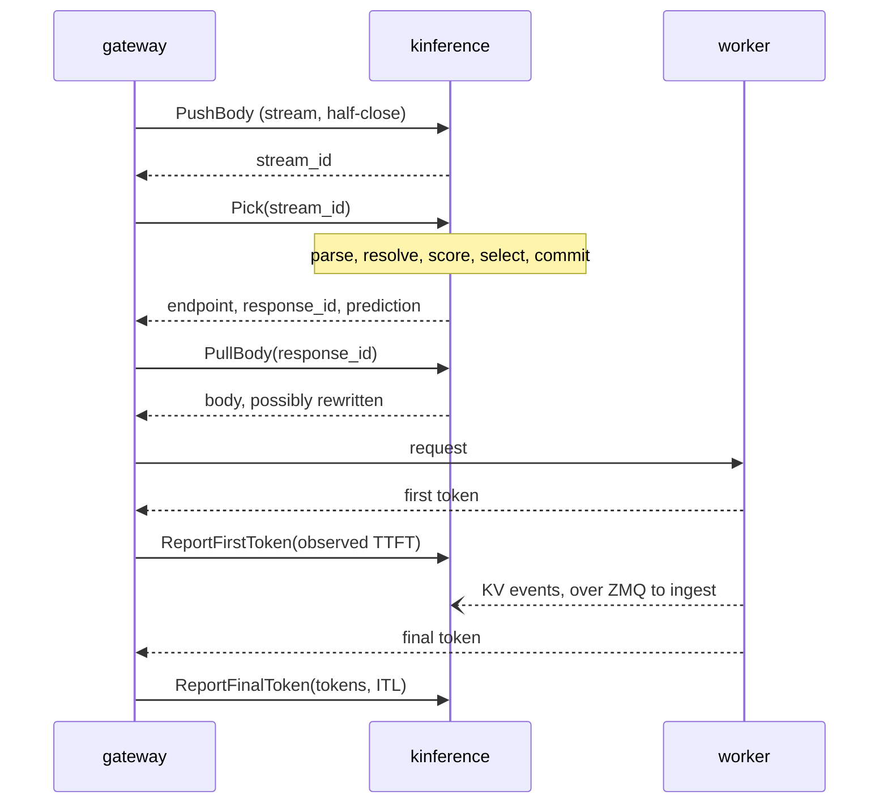

# Request flow

How kinference moves, in order: the boot sequence, one pick from pushed
body to reported tokens, and the loops that keep the fleet and the policy
current underneath. [ARCHITECTURE.md](../ARCHITECTURE.md) says what each
module owns; this page only says when it runs.

## Boot

`server::run` does the following, in this order.

1. Load and validate the config from the path on the command line. This
   is the only read of the environment.
2. Bind the gRPC listener, so a port clash fails before anything else
   starts.
3. Create the one Prometheus registry. Every subsystem below registers its
   families in it.
4. Create the policy store, if policy is enabled, and the provider health
   store. The policy store starts empty and `/readyz` reports not ready
   until the control plane has filled it.
5. Build the discovery factory from the controller crate. This is how the
   fleet gets Kubernetes discovery without holding a client.
6. `Fleet::new`. Builds the pool registry, the model index, the scrape
   registry, the coordinator and the pool manager. Nothing runs yet; the
   handles exist so the router can be built against them.
7. `KinferenceService::start`. Builds the tokenizer, the scoring reads over
   the fleet handles, the body store and the observations, and spawns the
   two sweeps that expire bodies and observations past their TTL.
8. `Fleet::start`. Materializes the worker sets declared in the config and
   runs the coordinator loop. From here workers can be added.
9. `controller::start`. Connects to the API server, runs the worker-set
   watch or, with Kubernetes off, only the reap sweep, then the CRD watch,
   the elector and the status and binding writers. Returns a handle whose
   `shutdown` is awaited at the end.
10. `admin::spawn`, if an admin address is configured. `/readyz`, `/metrics`
    and the read-only policy API.
11. Log READY and serve the `Picker` service until SIGTERM or SIGINT.

Shutdown is the reverse. The signal stops the gRPC server from accepting;
the cancellation token every task was given is cancelled; then
`Controller::shutdown` waits a bounded moment for the elector to vacate its
Lease, so a peer can take over without waiting for it to expire.

## One pick

The wire sequence is in the proto header: `PushBody`, `Pick`, `PullBody`,
`ReportFirstToken`, `ReportFinalToken`, and `Abort` if the request dies
after the pick. All of it is in `kinference-router`.

### PushBody

The caller streams the body in. `grpc::push_body` charges each chunk
against a `body_store::Reservation`, which enforces the per-request and
server-wide byte budgets and the idle budget between chunks. On a clean
half-close the reservation is committed and the body is stored under a new
`stream_id`, which is returned. A reset stream discards the bytes.

### Pick

`grpc::pick` takes the `stream_id` out of the body store with
`begin_pick`, so a second `Pick` on the same id fails, then calls
`service::lifecycle::pick_and_record`. That is five steps, each a method
whose typed result the next consumes.

1. Parse. The body becomes a JSON tree, kept as a tree so unknown fields
   survive the rewrite later. The `model` field is required; nothing else
   is.
2. Resolve the model. `auto` and declared aliases become a concrete model.
   The model index says which pools serve it. A model no local pool serves
   may still be served by a provider in the named `InferencePool`, so that
   is checked before refusing. The pick-time rewrites happen here, in
   `pick_body`: the resolved model, and `stream_options.include_usage` for
   streaming requests, so the final usage block exists to report later. The
   chat-template inputs are taken from the serialized body.
3. Score the groups. For the first pool serving the model,
   `service::scoring::score_workers` takes the ready workers, tokenizes the
   prompt through the pool's tokenize mode (in process, vLLM's `/render`, or
   both compared), then for each block size in the pool hashes the tokens
   into blocks and matches them against the pool's radix tree for the
   cached-prefix overlap per worker. The last scrape sample gives each
   worker's load. If tokenizing fails everywhere, scoring degrades to load
   only rather than failing the pick. Further pools serving the model are
   scored with the same tokens.
4. Select. With no `InferencePool` named, or policy disabled,
   `best_group` ranks the scored pools and the winner's group goes on.
   With a pool named, `service::policy_driver::policy_select` runs the
   compiled `InferencePolicy` over a snapshot of pools, worker sets and
   providers: candidates are flattened per endpoint, excluded, and ranked.
   Ranking holds no pool lock, because candidates may span pools, so the
   input may be one concurrent pick stale. The winner is either a local
   group or a provider. If the policy chose a different model than the
   body names, the body is rewritten again.
5. Commit. Under the winning pool's `pick_lock`, the only critical section
   on the request path. The picker in `picker` takes the scores, the
   in-flight counts and the dispatched prefixes per worker, computes the
   layered overlap and the predicted wait per worker, and chooses the
   endpoint. Then the bookkeeping: the in-flight count for that endpoint
   goes up, the prompt's prefix is recorded as dispatched so the next pick
   credits this worker before the engine's events land, a
   `PendingObservation` with the prediction is stashed under the new
   `response_id`, and the routed counter is recorded. A provider winner
   skips the lock and the fleet bookkeeping and records a provider pick
   instead.

Back in `grpc::pick`, the rewritten body is committed to the body store
under the `response_id`, and the response carries the endpoint, the
prediction and the id.

### PullBody

`grpc::pull_body` takes the outbound body for the `response_id` as a lease
and streams it out. The caller forwards it upstream in place of what it
sent.

### ReportFirstToken

The caller reports the observed time to first token. `grpc::report_first_token`
calls `Observations::finalize`, which takes the pending observation back,
releases the in-flight count it held, and writes the predicted-versus-observed
row to the CSV sink. For a provider pick there is no pending observation;
the report feeds provider health instead. A report with an upstream status
of zero means no response reached the caller, and is treated as not
dispatched: it releases through `abort_request` rather than finalizing.

### ReportFinalToken

After the response completes, the caller reports the served model, token
counts and the inter-token latency histogram. `grpc::report_final_token`
records them as request-path metrics and, for a provider, as feedback on
that provider.

### Abort

If the request will never dispatch, `abort_request` releases the body, the
pending observation and its in-flight state, without a CSV row. The reason
is counted, and for a provider it is folded into provider health.

### Backstops

A caller that never reports leaves state behind. The observation sweep
expires pending observations past their TTL and releases their in-flight
state; the body sweep reclaims buffered bodies past theirs. Both run on a
fixed interval from `KinferenceService::start`.

## The loops underneath

### Workers arriving and leaving

Each pool's discovery task is the source of truth for which workers exist.
In Kubernetes it is `controller::discovery::KubeDiscovery`, which watches
the EndpointSlices of the worker set's Service, derives the set of Ready
endpoints on every event, and diffs it against what it already announced.
A worker's identity is a hash of the pod's UID, so a restarted pod is a
new worker with an empty cache view.

Each `WorkerChange` reaches the coordinator's inbox. On `Added`,
`fleet::coordinator` registers the worker in the pool's registry and the
fleet-wide indexes, then spawns its two tasks under a per-worker
cancellation: the ZMQ ingest listener in `ingest`, and the metrics poller
in `scrape`, with a one-shot `/v1/models` fetch to learn its models and
engine at once. On `Removed`, or on an eviction request, the coordinator
cancels those tasks and drops the worker from every store, but only if the
pool asking is the one that registered it.

Eviction requests come from the worker's own tasks: ingest sees events at a
block size other than the pool's, or the poller sees a `/v1/models` list
that disagrees with the pool's canonical set. The request goes over the
eviction channel; the coordinator does the teardown, so lifecycle logic
stays in one place.

### KV events

Per worker, the ingest task holds a SUB socket for live events and a
DEALER socket for replay. Each frame's events are applied to the pool's
radix tree and to the in-flight prefix tracker, which retires a dispatched
prefix block by block as its stored events land. A sequence gap triggers a
replay request; replayed events are applied in order, then the live frame.

### Metrics

Per worker, the poller fetches `/metrics` on the configured interval and
`/v1/models` less often, and records the sample in the scrape registry
that scoring reads. The worker registry takes the models each worker
reports, and the pool's claim on them goes into the model index, which is
how a model becomes routable.

### The control plane

`controller::start` runs these tasks, all through `api::ApiServer`.

- The worker-set watch. Every `InferenceWorkerSet` event is a wakeup; the
  desired pools are re-derived from the whole store and handed to the pool
  manager's `reconcile`, which creates, updates and retires pools. A set
  that names an unknown profile or an invalid block size is rejected on
  its own and reported on its status, and the rest proceed. Reconciling
  waits for the initial list to complete, since a partial store would
  retire every pool and discard its prefix cache. The reap sweep runs
  regardless.
- The policy watch. Reflectors on `InferencePool`, `InferencePolicy`,
  `InferenceWorkerSet`, `InferenceProvider`, `HTTPRoute` and
  `ReferenceGrant` feed `kinference_policy::resolve`, a pure function over
  their contents, and the result is published into the policy store the
  pick path reads. Publishing is gated on every kind having listed once.
  A seventh reflector, on `Service`, is attached to the snapshot for port
  numbers but holds no gate.
- The elector. One Lease per deployment; the holder renews inside a grace
  window, a rival waits out the expiry, and a clean shutdown vacates it.
  The result is a boolean watch channel. With election disabled the
  channel is simply true.
- The status writer. Computes status for the policy resources from the
  snapshot and the live pool facts, and patches only what differs from the
  last write, which is what keeps its own watch from waking it forever. A
  conforming gateway programs no route until the pool reports
  `Accepted=True`, so nothing routes until this has run once.
- The binding writer. One `BackendBinding` per `InferencePool`, named
  after it, in its namespace, translating the pool's destinations into
  kinds the gateway can resolve.

Leadership gates only the two writers. The watches and the elector run on
every replica, and routing never waits on any of them.
